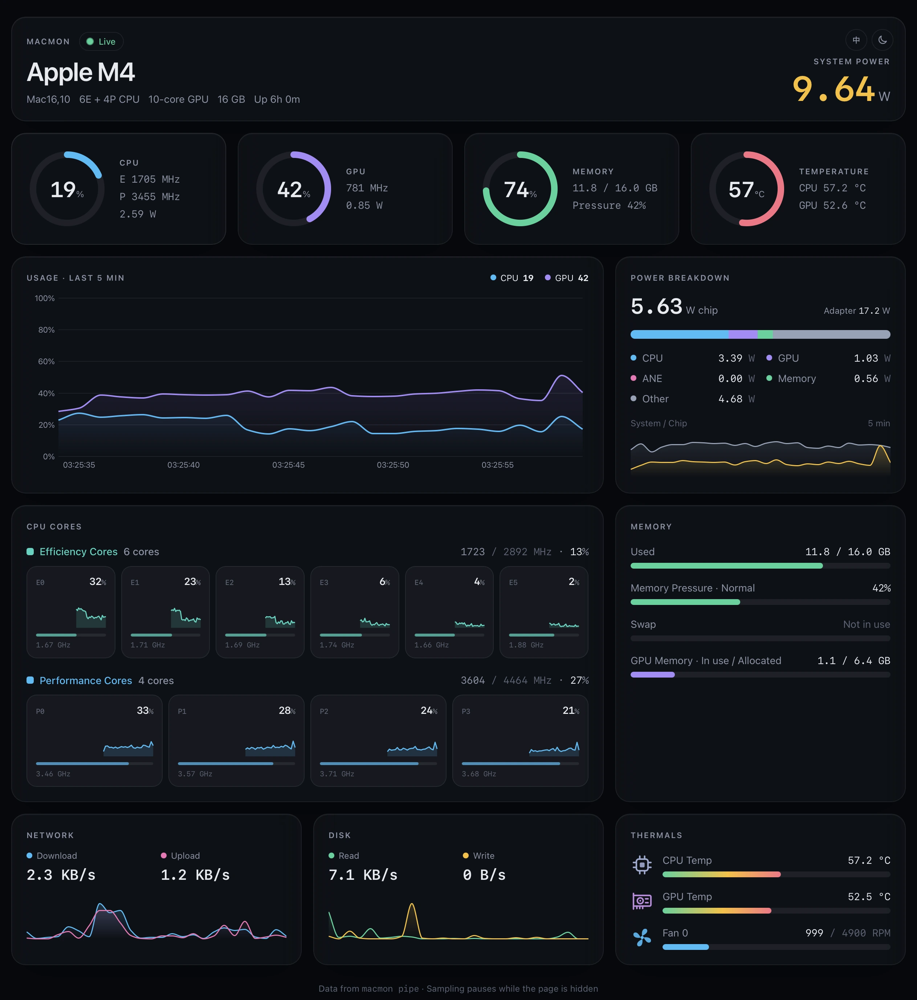
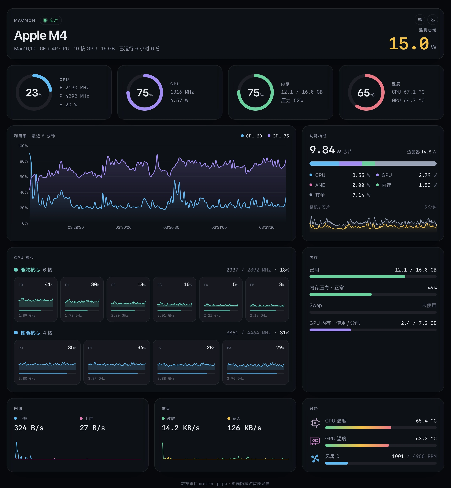
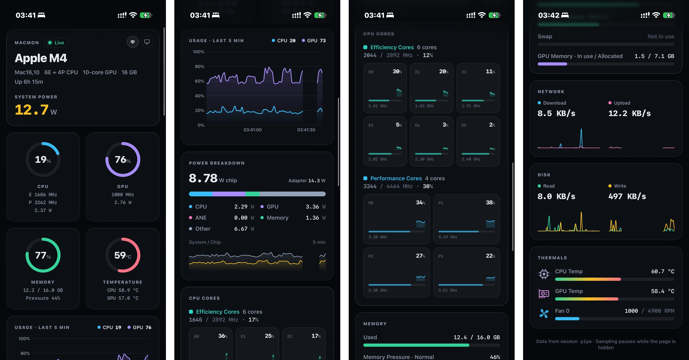

# macmon-web

English | [简体中文](README.zh-CN.md)

A lightweight web dashboard for [macmon](https://github.com/vladkens/macmon). Real-time CPU / GPU / power / memory / temperature / fan / network / disk monitoring for Apple Silicon Macs, in your browser.

- Single Go binary, frontend assets embedded, no CDN — works offline
- No `sudo` required (macmon itself doesn't need it)
- Samples only while a page is open; near-zero overhead otherwise
- English / Chinese UI (follows the browser language) and light / dark theme (follows the system); both can be switched from the top-right of the header
- Mobile-friendly: with `-addr 0.0.0.0:8000` you can open it from your phone on the same LAN, and "Add to Home Screen" to use it as a standalone app



<details>
<summary>Chinese UI</summary>



</details>

On mobile (the full page, top to bottom):



## How it works

```
Browser ──SSE /api/stream──▶ macmon-web (single Go binary) ──▶ macmon pipe (started on demand)
```

- `macmon pipe` is started only when at least one page is connected, and stopped 30s after the last one disconnects. When nobody is watching, only an idle Go process remains.
- Pages disconnect when hidden (`visibilitychange`) and reconnect when visible again.
- Does not rely on `macmon serve` (it sends no CORS headers, so browsers can't read it cross-origin).

## Requirements

- macOS on Apple Silicon
- `brew install macmon`
- Go 1.22+ (to build)
- bun (only for regenerating CSS after style changes; `web/dist/app.css` is committed, so a plain `go build` doesn't need it)

## Usage

```sh
make build      # builds ./macmon-web (Go only)
./macmon-web    # open http://127.0.0.1:8000
```

Flags:

| Flag | Default | Description |
| --- | --- | --- |
| `-addr` | `127.0.0.1:8000` | Listen address; use `0.0.0.0:8000` for LAN access |
| `-interval` | `1s` | Sampling interval |
| `-idle` | `30s` | Stop macmon after no clients for this long |
| `-macmon` | `macmon` | Path to the macmon binary |
| `-probe` | empty (off) | Latency probe targets, see [Latency probing](#latency-probing-optional) |
| `-probe-interval` | `1m` | Probe interval (minimum `15s`) |
| `-probe-keep` | `720h` | How long to keep latency history |
| `-probe-data` | `~/Library/Application Support/macmon-web/latency.jsonl` | Latency history file |

> There is no authentication. If you bind to `0.0.0.0`, anyone on your network can view the dashboard.

### Run at login (optional)

```sh
make install-agent                        # build and register as a user LaunchAgent, start immediately
make install-agent ADDR=0.0.0.0:8000      # custom listen address
make install-agent PROBE='Router=192.168.1.1:80,tls:Google=google.com:443'   # with latency probing
make uninstall-agent                      # stop and remove
```

- The plist is written to `~/Library/LaunchAgents/local.macmon-web.plist`; logs go to `~/Library/Logs/macmon-web.log`.
- The absolute paths of macmon (launchd's `PATH` doesn't include `/opt/homebrew/bin`) and of the binary in this directory are recorded at install time. After moving the repo, reinstalling macmon, or rebuilding, run `make install-agent` again.
- The process is restarted automatically if it crashes. Resident cost is small: macmon doesn't run while no page is open, and the Go process uses about 14 MB of memory.

### Latency probing (optional)

Off by default. Pass `-probe` to measure TCP / TLS latency to a few targets in the background — even when no page is open — and keep the history (30 days by default). A "Latency" card with a 1h / 6h / 24h / 7d / 30d chart then appears at the bottom of the page; drag across the chart to zoom into any time span.

```sh
./macmon-web -probe 'Router=192.168.1.1:80,tls:Google=google.com:443'
```

Targets are comma-separated `[tls:][name=]host:port`:

- **Direct** (default): times the TCP handshake with the socket bound to the physical interface, so it **bypasses TUN-mode proxies / VPNs** and measures your actual line. Domains are resolved through the DNS server of that interface, not the system resolver (which returns fake IPs under fake-ip proxies). IPv4 only. Targets that are unreachable without a proxy show 100% loss.
- **`tls:`**: times connect + TLS handshake through normal system routing, including any proxy — closer to what your browser experiences. Only for TLS ports (443 etc.); the number includes proxy overhead and is not a pure RTT.

Why not plain TCP connect or ICMP: a TUN proxy completes every TCP handshake locally, so a naive connect timer reports ~1 ms for any address; ICMP is often faked or dropped by proxies too.

Each cycle makes 5 attempts per target and records median / max / loss. Each target gets a card with its current status, avg / P95 / jitter / loss over the selected range, and a status strip that colors each slice of the range by packet loss. The chart uses a log scale, shows loss as red ticks along the bottom, and bridges stretches with no probes (e.g. while the Mac was asleep) with a dashed line, while full timeouts still break the line. When points are less than about 5 px apart (e.g. 6h or longer of per-minute data), the line is a rolling median trend with the raw values drawn faintly underneath so spikes stay visible; zoom in until points are further apart and it shows raw data. Hover a card to highlight its line, click it to hide / show; hover the chart for a tooltip with every target's raw values at that moment.

Drag horizontally across the chart with a mouse to zoom into that span (the start, end and duration are shown while dragging). While zoomed, the controls at the top right step half a window earlier / later or exit the zoom; double-clicking the chart also resets it. Touch devices only get the range buttons. For windows longer than 24 hours the server aggregates points into buckets of 2 minutes to 1 hour (median of medians, max, total loss), keeping the chart at about 1440 points at most; zooming into a day or less brings back the raw per-minute data. The avg / P95 / jitter / loss on the cards are always computed from the raw data.

History is appended to the `-probe-data` file as JSON Lines and compacted daily. Each target takes about 120 KB per day, about 4 MB for 30 days; the history is also kept in memory, about 30 MB for two targets over 30 days.

### Alerts (optional)

There are no built-in notifications, but `/api/json` makes a simple threshold alert easy to script. Example pushing to [Bark](https://github.com/Finb/Bark) or Telegram, saved as `~/bin/macmon-alert.sh` (`chmod +x`, requires `brew install jq`):

```sh
#!/bin/sh
set -eu
export PATH="/opt/homebrew/bin:$PATH"   # cron's PATH doesn't include Homebrew

TEMP_MAX=90                             # CPU temperature, °C
SWAP_MAX=$((4 * 1024 * 1024 * 1024))    # swap usage, bytes

json=$(curl -sf -m 10 http://127.0.0.1:8000/api/json)
msg=$(printf '%s' "$json" | jq -r --argjson t "$TEMP_MAX" --argjson s "$SWAP_MAX" '
  [ (select(.temp.cpu_temp_avg > $t) | "CPU \(.temp.cpu_temp_avg | floor)°C"),
    (select(.memory.swap_usage > $s) | "Swap \(.memory.swap_usage / 1073741824 * 10 | floor / 10) GB") ]
  | join(", ")')
[ -z "$msg" ] && exit 0
title="macmon: $(scutil --get ComputerName)"

# Bark
curl -sf -m 10 https://api.day.app/push -H 'Content-Type: application/json; charset=utf-8' \
  -d "$(jq -n --arg k "$BARK_KEY" --arg t "$title" --arg b "$msg" '{device_key: $k, title: $t, body: $b}')" >/dev/null

# Telegram (use instead of Bark)
# curl -sf -m 10 "https://api.telegram.org/bot$TG_TOKEN/sendMessage" \
#   --data-urlencode "chat_id=$TG_CHAT_ID" --data-urlencode "text=$title — $msg" >/dev/null
```

Run it every 5 minutes with `crontab -e`:

```
*/5 * * * * BARK_KEY=your_key $HOME/bin/macmon-alert.sh
```

- Each check briefly starts macmon (it stops again after `-idle`, 30s by default), so the "sample only on demand" property still holds; the cost is about 30s of sampling per check.
- It's a single-sample check: no "sustained for N minutes" or cooldown, so you get one notification per interval while a threshold is exceeded. Other fields can be checked the same way; see the output of `curl -s 127.0.0.1:8000/api/json | jq`.

### API

- `GET /api/stream` — Server-Sent Events, events `metrics` and `status`
- `GET /api/json` — single snapshot, for debugging
- `GET /api/latency?range=24h` or `?from=<unix sec>&to=<unix sec>` — latency history (columnar, uPlot-ready, aggregated for long windows, gzip supported); returns `{"enabled":false}` when `-probe` is not set

## Compatibility

Supports all Apple Silicon chips (M1–M4, including Pro / Max / Ultra). Intel Macs are not supported. CPU core cards are laid out dynamically based on the core clusters reported by macmon; on Ultra chips, cores of the two dies are labeled `D0·` / `D1·`.

> Ultra and three-cluster chips have only been tested with simulated data, not on real hardware. Bug reports are welcome.

## Development

```sh
make css-watch   # regenerate CSS while editing web/index.html / app.js / input.css; run `make css` once before committing for the minified build
go run .         # static assets are embedded via go:embed, so restart after frontend changes
```

Frontend: Tailwind CSS v4 + Alpine.js 3 + uPlot. Third-party libraries are vendored in `web/vendor/`.

## Acknowledgements

All metrics come from [macmon](https://github.com/vladkens/macmon) by [@vladkens](https://github.com/vladkens) (MIT). This project only runs the `macmon` binary as a separate process and does not include any of its source code. It is an independent project and is not affiliated with macmon.

## License

MIT, see [LICENSE](LICENSE).
