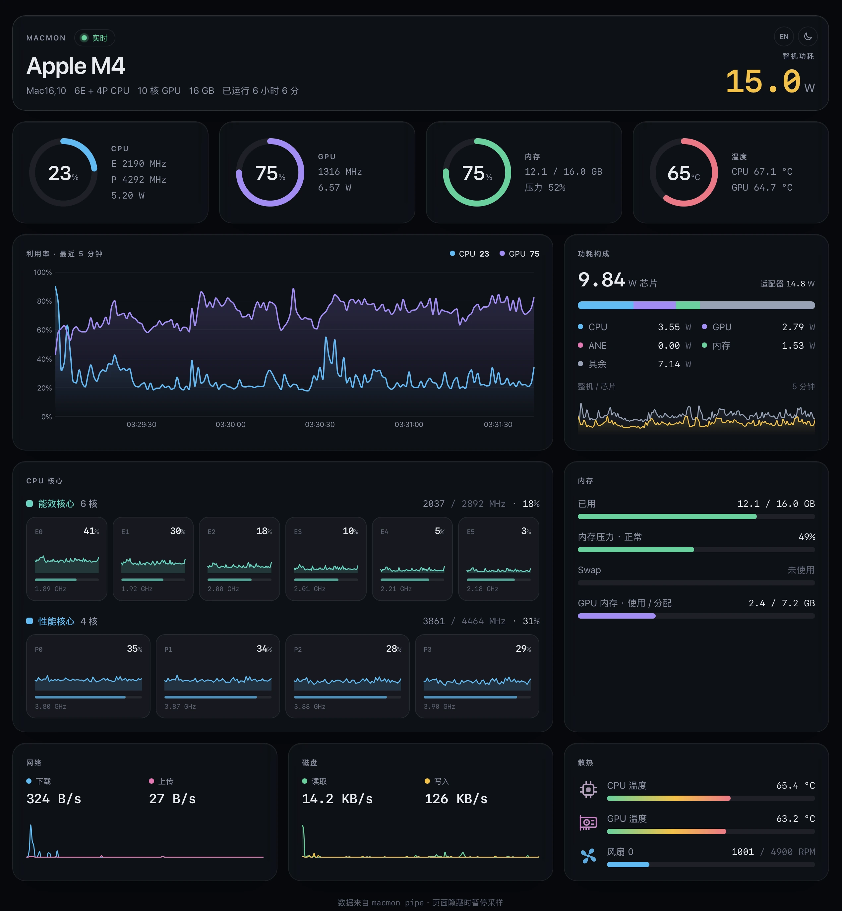
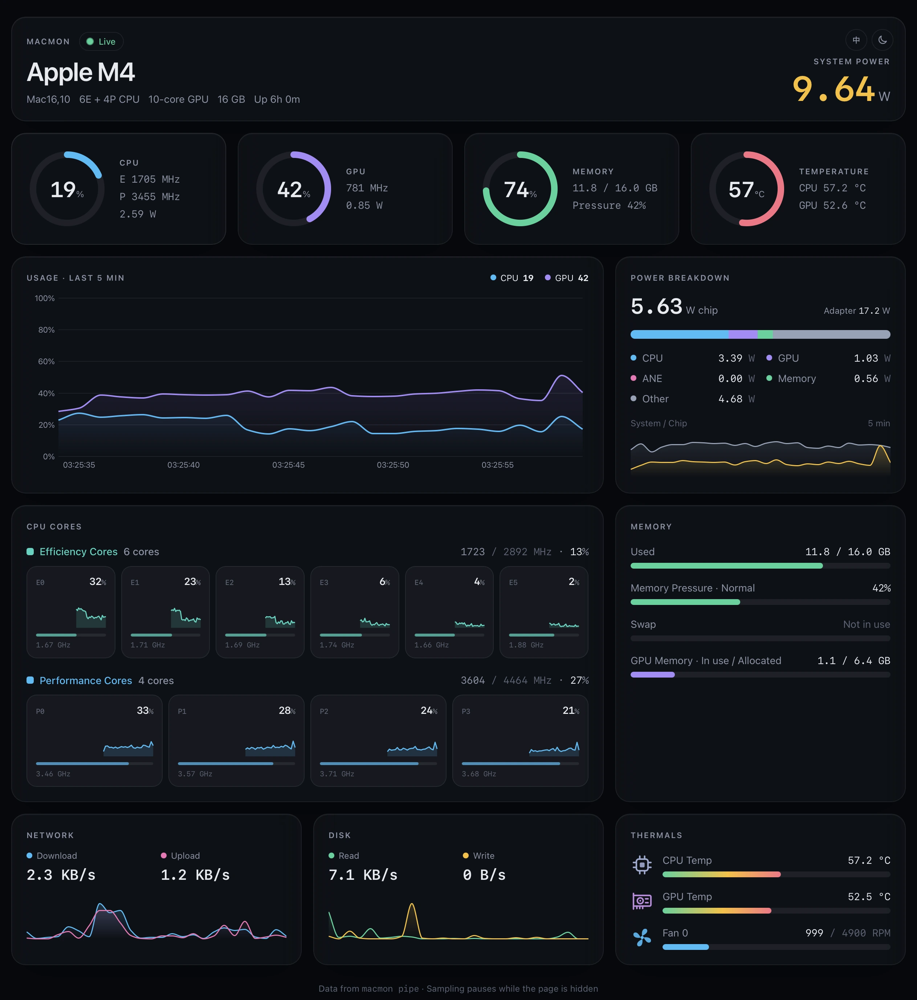

# macmon-web

[English](README.md) | 简体中文

[macmon](https://github.com/vladkens/macmon) 的自定义 Web 监控页。Apple Silicon 的 CPU / GPU / 功耗 / 内存 / 温度 / 风扇 / 网络 / 磁盘实时面板。界面支持中英文（默认跟随浏览器语言）和深浅色（默认跟随系统），可在顶栏右上角切换。



<details>
<summary>英文界面</summary>



</details>

## 工作方式

```
浏览器 ──SSE /api/stream──▶ macmon-web（Go 单二进制，前端资源内嵌）──▶ macmon pipe（按需拉起）
```

- 有页面在看时才启动 `macmon pipe` 采样；最后一个页面断开 30s 后结束子进程。没人看时只剩一个空闲的 Go 进程。
- 页面切到后台（`visibilitychange`）会主动断开，回到前台再重连。
- 不依赖 `macmon serve`（它不发 CORS 头，浏览器无法跨源直连）。

## 依赖

- `brew install macmon`
- Go 1.22+（构建）
- bun（只在修改样式、重新生成 CSS 时需要；`web/dist/app.css` 已提交，单纯 `go build` 不需要）

## 使用

```sh
make build      # 编译 ./macmon-web（只需 Go）
./macmon-web    # 打开 http://127.0.0.1:8000
```

参数：

| 参数 | 默认 | 说明 |
| --- | --- | --- |
| `-addr` | `127.0.0.1:8000` | 监听地址；要局域网访问改成 `0.0.0.0:8000` |
| `-interval` | `1s` | 采样间隔 |
| `-idle` | `30s` | 无客户端多久后停止 macmon |
| `-macmon` | `macmon` | macmon 可执行文件路径 |

### 开机自启（可选）

```sh
make install-agent                        # 编译并注册为当前用户的 LaunchAgent，立即启动
make install-agent ADDR=0.0.0.0:8000      # 自定义监听地址
make uninstall-agent                      # 停止并移除
```

- plist 写在 `~/Library/LaunchAgents/local.macmon-web.plist`，日志在 `~/Library/Logs/macmon-web.log`。
- 安装时会记录 macmon 的绝对路径（launchd 的 PATH 不含 `/opt/homebrew/bin`）和本目录下二进制的路径；挪动仓库、重装 macmon 或重新编译后，再执行一次 `make install-agent` 即可。
- 进程异常退出会自动拉起；常驻开销很小：没人打开页面时不运行 macmon，Go 进程内存约 14MB。

### 告警通知（可选）

本项目不内置通知，但借助 `/api/json` 很容易用脚本实现阈值告警。下面是推送到 [Bark](https://github.com/Finb/Bark) 或 Telegram 的示例，保存为 `~/bin/macmon-alert.sh`（`chmod +x`，需要 `brew install jq`）：

```sh
#!/bin/sh
set -eu
export PATH="/opt/homebrew/bin:$PATH"   # cron 的 PATH 不含 Homebrew

TEMP_MAX=90                             # CPU 温度，°C
SWAP_MAX=$((4 * 1024 * 1024 * 1024))    # swap 用量，字节

json=$(curl -sf -m 10 http://127.0.0.1:8000/api/json)
msg=$(printf '%s' "$json" | jq -r --argjson t "$TEMP_MAX" --argjson s "$SWAP_MAX" '
  [ (select(.temp.cpu_temp_avg > $t) | "CPU \(.temp.cpu_temp_avg | floor)°C"),
    (select(.memory.swap_usage > $s) | "Swap \(.memory.swap_usage / 1073741824 * 10 | floor / 10) GB") ]
  | join(", ")')
[ -z "$msg" ] && exit 0
title="macmon: $(scutil --get ComputerName)"

# Bark
curl -sf -m 10 https://api.day.app/push -H 'Content-Type: application/json; charset=utf-8' \
  -d "$(jq -n --arg k "$BARK_KEY" --arg t "$title" --arg b "$msg" '{device_key: $k, title: $t, body: $b}')" >/dev/null

# Telegram（替换 Bark 使用）
# curl -sf -m 10 "https://api.telegram.org/bot$TG_TOKEN/sendMessage" \
#   --data-urlencode "chat_id=$TG_CHAT_ID" --data-urlencode "text=$title — $msg" >/dev/null
```

用 `crontab -e` 每 5 分钟执行一次：

```
*/5 * * * * BARK_KEY=your_key $HOME/bin/macmon-alert.sh
```

- 每次检查会短暂拉起 macmon（`-idle` 后自动停止，默认 30s），不破坏“按需采样”；代价是每次检查约 30s 的采样。
- 这是单次采样判断：没有“持续 N 分钟”和冷却，超阈值期间每个周期都会推送一次。其他字段可以照此判断，字段见 `curl -s 127.0.0.1:8000/api/json | jq` 的输出。

接口：`GET /api/stream`（SSE，事件 `metrics` / `status`），`GET /api/json`（单次快照，调试用）。

## 兼容性

支持 Apple Silicon 全系（M1–M4 及 Pro / Max / Ultra），不支持 Intel 机型。CPU 核心卡片按 macmon 上报的核心簇动态布局，Ultra 的双 die 核心以 `D0·` / `D1·` 区分。

> Ultra 和三簇芯片只用模拟数据验证过，未经真机测试，遇到问题欢迎反馈。

## 开发

```sh
make css-watch   # 改 web/index.html / app.js / input.css 时实时生成 CSS；提交前跑一次 make css 生成压缩版
go run .         # 静态资源是 go:embed 嵌入的，改前端后需重启
```

前端：Tailwind CSS v4 + Alpine.js 3 + uPlot，第三方库放在 `web/vendor/`（离线可用，不走 CDN）。

## 致谢

所有指标数据来自 [@vladkens](https://github.com/vladkens) 的 [macmon](https://github.com/vladkens/macmon)（MIT）。本项目只以独立子进程方式调用 `macmon` 可执行文件，不包含其源代码；与 macmon 官方无关联。

## 许可证

MIT，见 [LICENSE](LICENSE)。
